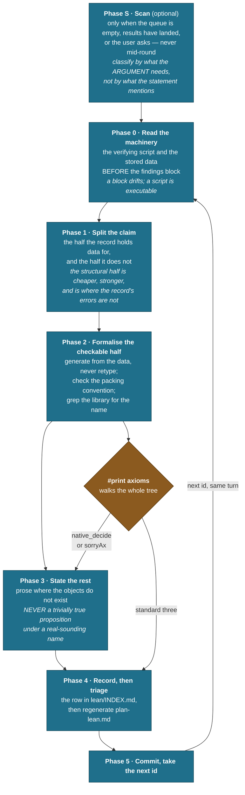
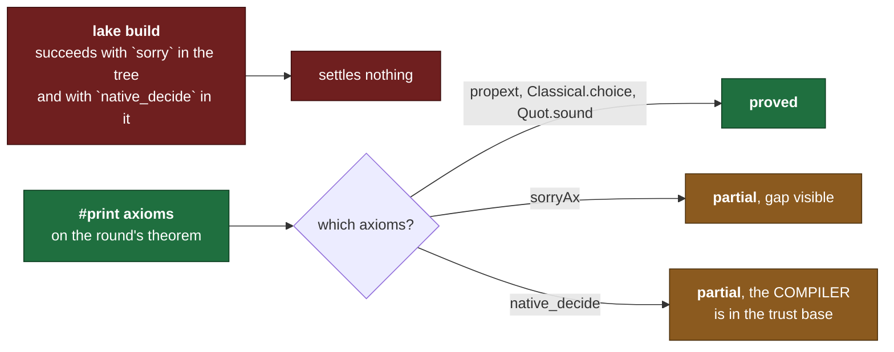

# Lean loop, at a glance

**The machine checks the record. [SKILL.md](SKILL.md) is the authority; this file is the shape of it.**

One numbered result per **round**. A round ends with that id carrying one of [lean-layer.md](../lean-layer.md)'s four states in [lean/INDEX.md](../../../lean/INDEX.md), and the next id opened in the same turn.

## The round

## What makes this loop different

**It spawns no agents. The kernel is the adversary.** Every other loop here fans out because a reader can be wrong and independent readers are the only correction. A proof that type-checks needs no corroboration, and one that does not is not improved by a second opinion.

**What that trades away**: a kernel checks the proof it was given, never whether the statement is the one the record meant. **Statement fidelity is this loop's whole exposure**, which is why a round quotes the source rather than paraphrasing it.

**A row's state is settled by [axiom_audit.py](../../../scripts/misc/axiom_audit.py), never by the build succeeding.**

## What the loop does not do

**It does not repair the record.** A defect it finds is queued, and the repair belongs to whichever loop owns the mathematics.

**It does not compute to fill a gap.** Where a proof needs data the record does not hold, that is the finding.
