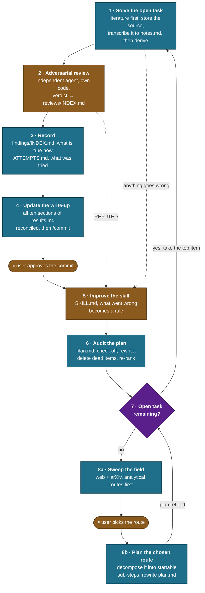
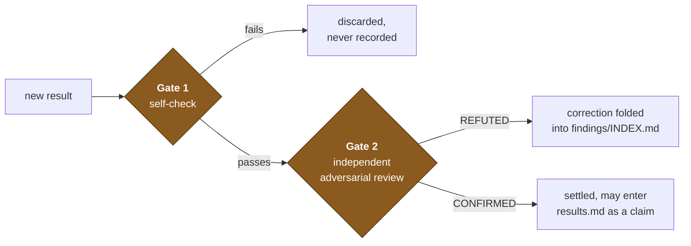

# research-loop

A self-continuing research cycle for the Conjecture A programme. Invoke it with `/research-loop`; the full instructions live in [SKILL.md](SKILL.md).

One pass through steps 1–9 is one **cycle**. Step 8 hands back to step 1, so the loop runs inline in a single session until the user interrupts, a commit needs approval, or a stop condition fires.

## The circular flow



## The agent budget, and the model

The cycle runs inline. **One step spawns a subagent**, step 2's reviewer, where a cold start is the point rather than a cost. Everything else stays in the session, because context is what each step is built on.

**Every step runs on one model, and each one checks before starting.** Step 9 does the sweep, the ranking and the planning in-session, with the cycle's full context. The reading sets the ceiling: shallow reading yields shallow routes however they are ranked.

## What each step is for

| Step | Produces | The rule that governs it |
|---|---|---|
| 1 · Solve | A result that passed Gate 1 | Search the literature before deriving anything; store every source under [references/](../../../references/) and transcribe each extraction into its `notes.md` |
| 2 · Review | A CONFIRMED / PLAUSIBLE / REFUTED verdict in [reviews/INDEX.md](../../../reviews/INDEX.md) | The reviewer writes its own implementation and tries to break the result |
| 3 · Record | [findings/INDEX.md](../../../findings/INDEX.md) reflecting what is true now, [ATTEMPTS.md](../../../ATTEMPTS.md) recording what was tried | Corrections are applied in place, never appended; delete refuted claims outright, along with everything resting on them |
| 4 · Write up | [results.md](../../../results.md) and a commit | Every update reconciles all ten sections, never just the new entry; literal Lemma/Observation/Conjecture labels; Gate 2 material only; the user approves each commit |
| 5 · Improve | An edit to [SKILL.md](SKILL.md) | Every failure mode becomes a positive instruction |
| 6 · Audit | [plan.md](../../../plan.md) re-ranked by what now blocks the goal | Five fixed sections, under ~15 KB, state only, process rules live in [SKILL.md](SKILL.md). Dead items are deleted rather than archived, but the fence posts, the named fallback and the Gate 2 ledger always survive |
| 7 · Choose | The next task | The top item is genuinely the top item |
| 8 · Research | A rewritten plan built on the route the user chose | Four phases: brief the user, pick the model and sweep the field, propose two to four ranked routes and **stop for their choice**, then plan it. Analytical routes outrank numerical ones |

## The two gates

Results cross two independent checks. Conflating them is what let a round of unreviewed work reach [findings/INDEX.md](../../../findings/INDEX.md).



**Gate 1** is four checks the author runs before writing anything down: reproduce a trusted value, reach the number by a second route sharing no code, screen the object's validity directly, and test the value against known ceilings. Every write-up states which it passed.

**Gate 2** is a separate agent working from the definitions alone, writing its own implementation, hunting for the counterexample. Its verdict is binding.

## Standing priorities

- **Literature first, derivation last.** A round was already spent re-deriving [arXiv:2311.02404](https://arxiv.org/pdf/2311.02404) from scratch.
- **Analytical over numerical.** Numerics screen and catch errors; the target is a closed-form proof.
- **Delete boldly.** Refuted findings and dead plan items come out entirely.
- **Persistence is the point.** The loop continues by default and stops for the user's decisions, not for difficulty.

## The references folder

Each consulted source gets a subfolder under [references/](../../../references/):

```
references/<slug>/
  README.md     the index card, what this source is, what it was consulted for,
                link, authors, arXiv id and version, date retrieved, and the verdict
  notes.md      the extraction transcribed into readable markdown, numbered statements
                verbatim in LaTeX with full hypotheses, the proofs that matter, what they cite
  <paper>.pdf   the source as retrieved
  <paper>.txt   pdftotext -layout output, for grepping
```

**Any PDF put through an extraction tool gets its result transcribed into `notes.md`.** The `.txt` dump exists to be grepped; `notes.md` is what a later cycle opens and quotes from, so the paper is read once rather than every cycle.
