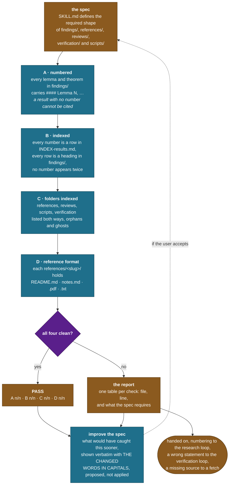

# structure-check

A compliance check over the record's folders. Invoke it with `/structure-check`; the spec and the checks live in [SKILL.md](SKILL.md).

**Four checks in one straight line, then a report.** It reads and never repairs, a failing check names the file, the line and the rule, and the fix is somebody's decision.

## The line

## What each check is for

| check | catches | why it matters |
|---|---|---|
| **A · numbered** | a result stated under a narrative heading only | nothing can cite it, so it gets restated instead, and restatements drift |
| **B · indexed** | a number missing from the index, an index row with no result, or **one number on two headings** | the third is worst: two statements sharing one address, and a citation that means either |
| **C · folders indexed** | orphans and ghosts | a ghost is a broken citation; an orphan is work nobody can find |
| **D · reference format** | a source with no PDF, no notes, no extraction or no index card | a hypothesis check that cannot point at a line in the source is an opinion |

## The one exception in the spec

**A source that could not be obtained passes without a PDF**, provided its `README.md` carries a `Not obtained` section naming what was tried. A record that says "this source is not on file" is correct. A folder holding a substitute paper, or a summary standing in for one, is not, this project has had a summarization layer fabricate a reference once, which is why the rule reads that way.

## The last step

**Every run ends by proposing what would improve the spec**, shown verbatim with the changed words in CAPITALS so the reader sees the edit rather than a description of it. **Proposed, never applied**, the spec is what the record is checked against, and a skill that edits its own spec after a failing run can define its failures away.

The case that earns one: a check demanding one form of indexing while the index legitimately uses another, which reports most of the corpus as broken.

## What it does not do

**It does not repair**, because a missing heading, a stale index row and an unfetched PDF each have a right fix that depends on why they happened, and a check that quietly fixes things stops being a check.

**It does not judge mathematics.** Whether a `Lemma` deserves the label is Gate 2's question; this skill checks the label is present, unique and indexed.
