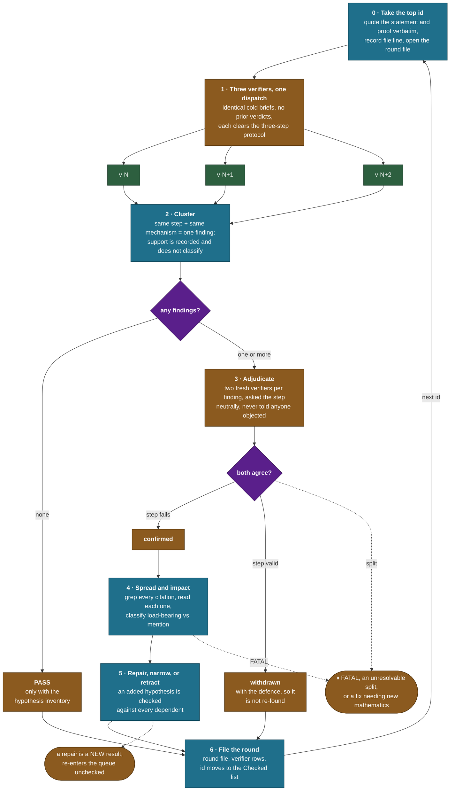
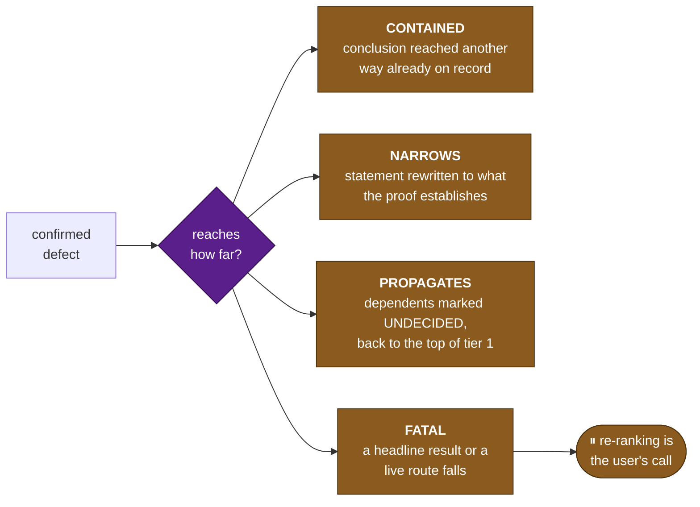

# verification-loop

An audit loop over the numbered results of the Conjecture A programme. Invoke it with `/verification-loop`; the full instructions live in [SKILL.md](SKILL.md).

One numbered result is one **round**. Phase 6 hands back to phase 0, so the loop runs inline in a single session until the user interrupts or a stop condition fires. The queue and the verdicts live in [plan-verification.md](../../../plan-verification.md), as ids pointing at [findings/INDEX.md](../../../findings/INDEX.md), which owns the numbering, the statements and the files.

**This loop checks the record. The [research-loop](../research-loop/SKILL.md) extends it.** Where they touch the same files they collide, so run this one in its own worktree.

## The round



## Two layers, and why each spends what it spends

**Layer 1 buys recall.** The errors a cold reader catches are drawn from a wide distribution, and one draw misses most of it, independent readers rarely find each other's defects. Three draws sample it three times, and the round is cheap because nothing computes.

**Layer 2 buys independence, not votes.** The loop wrote the brief and has read every report, so it is the least independent reader available; two fresh readers decide instead. **Two rather than three because three settles a 2–1 split by vote**, and a proof step is not a thing to average, at two, agreement decides and disagreement goes to derivation.

**Support is recorded and does not classify.** Every distinct finding is adjudicated, whether one verifier raised it or three: at three draws the gap between one and three is too thin to route on, and a defect only one reader saw is the case this loop exists for.

**A pass is the asymmetric case.** Independent readers converging on the same step is strong evidence of a defect; converging on "no defect" is weak evidence of correctness, because a shared blind spot produces exactly that shape. So a pass rests on the enumeration each verifier returns of what it actually checked, **a thin or generic inventory is a failed round to be re-run**, not a pass.

| round shape | agents |
|---|---|
| clean pass | **3** |
| one finding | **5** |
| two findings | **7** |

## What each phase is for

| Phase | Produces | The rule that governs it |
|---|---|---|
| 0 · Brief | [verification/ROUND_&lt;id&gt;.md](../../../verification/) with the source lines | **Quote, never paraphrase.** A paraphrase is the one error three independent verifiers cannot catch, because all three inherit it |
| 1 · Dispatch | Three `VERIFY_v<N>.md`, each with a hypothesis inventory | Withhold every prior verdict and the author's reasoning; each verifier re-derives, exhibits the failure in closed form, and argues the opposite before writing a finding down |
| 2 · Cluster | The clustering table, and two checks that cost nothing | Cluster by the **step attacked**, never by the wording. Re-read the brief against the source, and search the whole record before accepting "no argument on file" |
| 3 · Adjudicate | Each finding confirmed or withdrawn, with the defence | Two fresh verifiers get the step and a neutral question, never the accusation. **The neutral question is also the defence**, so the case for the old text is made by readers never told it was under attack. A proposed counterexample **object** is the one thing passed on |
| 4 · Spread | The dependent set and an impact class | Read each citation rather than counting hits: load-bearing or mention |
| 5 · Fix | A repair, a narrowing, or a retraction | A repair is a new result and is not blessed by its author. **A hypothesis added to save a lemma is checked against every use of it** |
| 6 · File | Verifier rows, and the id moved in [plan-verification.md](../../../plan-verification.md) | Ids reopened by a propagating defect are added back in the same edit |

## Impact classes

What a confirmed defect costs is decided before anything is repaired, because the fix is local and the damage is not.



## Zero numerics, and what that buys

**No verifier runs a script, and neither does the round.** A counterexample is exhibited in closed form or it is not a counterexample. This is stricter than the research loop's ordering, and deliberately so: the record was built with numerics, and the arguments are what went unchecked.

The record's own standing rule says why sampling cannot settle these questions, *a control drawn from a distribution that avoids the counterexample family cannot see it.* Every interesting failure in this programme lives on a measure-zero set, and random draws are the one method guaranteed to miss it.

A finding that genuinely needs a computation is filed as `UNRESOLVED, needs computation`, naming the quantity and what its value would decide, and handed to the research loop where numerics are legal instruments.

## The queue

**Tier 0 first (the statements that fix what is being proved) then by exposure within each tier.**

```
exposure = citations across the record / (1 + reviews/ files naming the result)
```

High exposure is load-bearing and thinly checked. Two rules override the order: **a dependency is checked before its dependents**, and a row marked `UNDECIDED, depends on <id>` re-enters at the top of tier 1.

**Checked means one thing: a completed round of this loop.** A Gate 2 verdict from the research loop lowers a row's exposure and moves it down the queue; it does not check it. That follows the record's own rule that a filed verdict is evidence rather than authority.

Two kinds of row stay outside the rounds. **Observations** are verified numerically at the dimensions stated, so they have no proof to audit, what is checked instead, inline, is whether the record cites them as though they were proved. **Conjectures** have no proof at all; one enters the queue at tier 1 on the day it gets one.

## What breaks independence

Three verifiers are worth three draws only while nothing correlates them. Each of these collapses the round to one draw, silently:

- **A paraphrased statement**, all three inherit it.
- **The author's reasoning in the brief**, all three inherit it, and it is the least tested thing in the record, written after the result.
- **Any prior verdict, verifier number, or confidence signal.**
- **Verifiers reading each other**, or the round file, or another's log.
- **A shared convention taken from one constructor**, readers who inherit a sign or a normalisation from the same source report the same error and agree.

## Standing priorities

- **The proof, not the numbers.** "Verified at $n=12,14,16$" is an open hypothesis, and naming it one is the whole point of the loop.
- **Every finding is adjudicated, none is binned.** Two verifiers per finding is cheaper than either mistake.
- **Trace before fixing.** A repair aimed at one citation out of forty is not a repair.
- **Persistence is the point.** The loop continues by default and stops for the user's decisions, not for difficulty.
