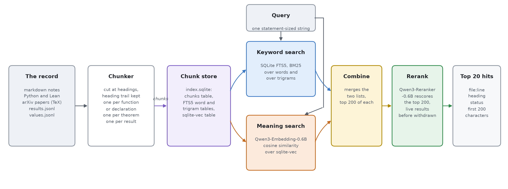

# Retrieval over the research record

A retrieval tool over the research record. Given a question, it returns the passages of the record that answer it, as file and line, with live results ahead of withdrawn ones. It searches notes, scripts, Lean files and the papers in references/.

| part | what is used |
|---|---|
| store | one [SQLite](https://sqlite.org) file, `.rag/index.sqlite`, holding chunks, keyword indexes and vectors |
| keyword search | SQLite [FTS5](https://sqlite.org/fts5.html), BM25 over a word index and a trigram index |
| meaning search | [Qwen3-Embedding-0.6B](https://huggingface.co/Qwen/Qwen3-Embedding-0.6B), run locally at fp16 on the GPU, vectors stored with [sqlite-vec](https://github.com/asg017/sqlite-vec). The weights, 1.2 GB, sit in the Hugging Face cache at `~/.cache/huggingface/hub/models--Qwen--Qwen3-Embedding-0.6B`, downloaded once on first use and read offline after |
| fusion | reciprocal rank fusion of the two rankings |
| reranking | [Qwen3-Reranker-0.6B](https://huggingface.co/Qwen/Qwen3-Reranker-0.6B) reads the question and each of the fused top 200 together and rescores them, then live results go first. Local at fp16, 1.1 GB in the Hugging Face cache at `~/.cache/huggingface/hub/models--Qwen--Qwen3-Reranker-0.6B`. It took the evaluation's top-ten hits from 4 to 7 of 26 ([reranker.md](experiment/reranker.md)) |
| runtime | Python 3.14, with sentence-transformers, transformers and PyTorch for the models, in the project `.venv` |

Everything the tool generates lives under `.rag/`, which is gitignored: the registries, the paper sources, the vector cache and the index. The code in this folder is committed.

## 1. Using the tool

```
python3 scripts/rag/registries.py . .rag/head                              # results, values and paper manifest
python3 scripts/rag/fetch_sources.py .rag/head/manifest.tsv .rag/papers   # arXiv TeX sources, rerun when a paper is added
.venv/bin/python scripts/rag/rag.py index                                   # chunks, keywords and vectors into .rag/index.sqlite, about 2 minutes
.venv/bin/python scripts/rag/rag.py index --keyword                         # keywords only, standard library, about 20 seconds
.venv/bin/python scripts/rag/rag.py query "<text>"                          # fused and reranked, top twenty hits, live first, about 50 seconds
.venv/bin/python scripts/rag/rag.py query "<text>" --no-rerank              # fused without reranking, about 6 seconds
.venv/bin/python scripts/rag/rag.py query "<text>" --keyword                # keyword search alone, under a second
```

### 1.1 How it works



***Fig. Retrieval tool pipeline.*** *The record is cut into chunks along its own structure and stored in one SQLite file, index.sqlite, which holds the chunks, the FTS5 keyword tables and the sqlite-vec vector table. One query is run against it two ways. Keyword search ranks chunks by BM25 over a word index and a trigram index. Meaning search ranks them by cosine similarity of Qwen3-Embedding-0.6B vectors. Fusion merges both rankings by reciprocal rank, the reranker rescores the fused top 200 against the question, and live results go ahead of withdrawn ones. Drawn by [pipeline.py](figures/pipeline.py).*

1. **Chunk.** [rag.py](rag.py) cuts markdown at headings and keeps the heading trail on every chunk, cuts code per function and Lean per declaration, cuts arXiv papers per theorem environment from their TeX source, and adds one chunk per numbered result and per recorded value. Each chunk carries its file, line range, heading and status (`live`, `withdrawn`, `superseded` or `history`).
2. **Search by keyword.** SQLite FTS5 ranks chunks by BM25 twice, over whole words and over trigrams, and the two lists are fused by reciprocal rank. This finds a chunk that shares the query's vocabulary.
3. **Search by meaning.** [rag.py](rag.py) embeds every chunk and the query with Qwen3-Embedding-0.6B, locally, and ranks by cosine similarity. This finds a chunk that states the same fact in other words. Vectors are cached by chunk hash, so an unchanged chunk is embedded once.
4. **Fuse.** The top 200 of each ranking are merged by reciprocal rank at k = 60.
5. **Rerank.** Qwen3-Reranker-0.6B reads the question together with each of the fused top 200, the chunk's first 1000 characters, and scores the probability that the chunk answers it. The 200 are reordered by that score, and live chunks are moved ahead of withdrawn, superseded and history ones. Reading both texts at once lets it judge a match that the separate vectors miss.
6. **Return.** The top twenty hits by default, set by `-k`, each as `file:line_start-line_end`, heading and the first 200 characters.


### 1.2 When the index updates

The index changes only when `rag.py index` runs. Nothing triggers it, so after a commit, an edit or a new paper the search returns the record as it stood at the last build.

| when | what the model embeds |
|---|---|
| `rag.py index` | the chunks whose text changed since the last build, seconds to minutes. Every other vector comes from the cache in `.rag/vec/qwen/`, keyed by chunk hash |
| `rag.py query` | the question only, and the reranker scores the 200 candidates. Loading the two models takes most of the fifty seconds |
| any other change to the record | nothing until the next `index` |

### 1.3 Scripts the tool uses

| script | what it does |
| --- | --- |
| [rag.py](rag.py) | chunking, the keyword and vector index, and `rag query` |
| [registries.py](registries.py) | builds the paper manifest, `results.jsonl` and `values.jsonl` from one tree, a checkout or a snapshot, read by the chunker |
| [fetch_sources.py](fetch_sources.py) | fetches each arXiv paper's e-print, three seconds apart, and flattens it to `source.tex` |

## 2. Formats

Python 3.14 standard library, plus sentence-transformers, PyTorch and numpy in a project `.venv` for meaning search. Data files are JSON Lines, UTF-8, one object per line, keys in the order given.

### 2.1 Registries

`.rag/head/results.jsonl` and `.rag/head/values.jsonl`, written by [registries.py](registries.py).

- **results:** `id`, `kind`, `status`, `statement`, `file`, `line`, `deps`, `lean`, `superseded_by`.
- **values:** `value` (the number as printed), `name`, `n`, `file`, `line`, `printings` (every other printing of the same value in the record).

### 2.2 Index and vectors

`.rag/index.sqlite`, WAL mode: `chunks(id, file, line_start, line_end, heading, kind, status, result_ids, hash, body)`, FTS5 tables `chunks_text` (`unicode61`) and `chunks_tri` (`trigram`) over `heading || body`, and a [sqlite-vec](https://github.com/asg017/sqlite-vec) table `chunks_vec(rowid, embedding float[1024], cosine)` holding one Qwen3-Embedding-0.6B vector per chunk, so text, keywords and vectors sit in one file of about 1 GB. The vector cache is `.rag/vec/qwen/<name>.npy`, fp16, with the chunk hashes in `<name>.json`.

### 2.3 Query output

One hit per line: `rank  status  file:line_start-line_end  heading`, then the first 200 characters of the chunk, indented.
