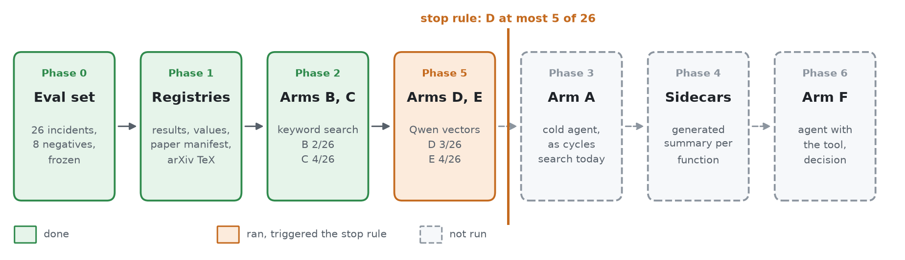

# Can retrieval stop a research agent from re-deriving what it already knows?

**Outcome: retrieval does not find what the record already held.** Of 26 real cases where a cycle re-derived a result the record already had, keyword search finds 4, meaning search with Qwen3-Embedding-0.6B finds 3, and the two fused find 4. Every hit of meaning search is also a keyword hit, and no comparison is significant. Meaning search stayed at or below the stop rule's bound of 5, so the tests with an AI agent never ran. The tool is kept as an optional lookup, with fused search as its default, since it costs no tokens and loses nothing against keywords alone.

| arm (search method) | found, of 26 |
|---|---|
| B, keyword search on raw files | 2 |
| C, keyword search on structured chunks | 4 |
| D, meaning search | 3 |
| E, C and D fused | 4 |

## 1. The question

A research cycle sometimes derives, proves or files as new a result that the repository already holds. The experiment asks whether a retrieval tool, queried with the cycle's own words, would have put the existing result in front of it. The tool is described in [README.md](../README.md).

## 2. The eval set

Each incident is a real miss from the repository's history, drawn and frozen before any arm ran.

- **Pool.** Files under reviews/, verification/, findings/ and results.md whose text matches `already (filed|in the record|on file|stated in|proved in|recorded)|RETIRED into|was already`: 291 files, read in an order fixed by seed 20261102.
- **Screening.** Ranks 0 to 245 were read by hand. 29 files gave incidents. The rest were skipped as another sense of the phrase (116), a target known to the work itself (66), no target named (17), a duplicate (12), or a claim that never reached the repository before its catch (6).
- **Two cold audits** removed every incident where the target postdates the claim, the work's own file cites the target, or the source was recorded under the wrong type. The frozen set holds **26 incidents** (22 targets are lines in markdown record files, 4 are Lean declarations) and 8 negatives, with SHA-256 `52e753c8…f784153`.
- **Each incident** carries the commit before the miss, the query (the commit subject and its `Deliverable:` line, or the derivation's heading), and the target as a file and line or a declaration.
- **Negatives** are results that were new when filed, so a correct search finds nothing.
- **Each arm runs at the incident's own snapshot**, `git archive` of that commit, so it sees the record exactly as the cycle did.

## 3. Design

An arm is one search method under test, named by a letter, like a treatment group in a clinical trial. The pipeline is drawn in [README.md](../README.md#11-how-it-works).

| arm (search method) | what it is |
|---|---|
| A | a cold agent searching as a cycle does today: the findings indexes in its prompt, five searches and two file reads |
| B | keyword search over the files as filed, in 40-line windows |
| C | keyword search over structured chunks, live results first |
| D | meaning search over C's chunks with Qwen3-Embedding-0.6B vectors, live results first |
| E | C and D fused by reciprocal rank |
| F | the agent of arm A with the tool as one of its searches |

B and C rank by BM25 over a word index and a trigram index, fused by reciprocal rank. C's chunks follow the record's structure: markdown at headings with the heading trail, code per function, Lean per declaration, papers per theorem from their TeX source, one chunk per numbered result and value. E fuses C's and D's top 200 at k = 60. The model choice for D is argued in [model-choice.md](model-choice.md).

- **Score.** Recall@10: a hit is a top-ten chunk covering the target line within two lines, the target declaration, or the target's result id.
- **Win rule,** fixed in advance: exact two-sided McNemar p < 0.05 on the discordant pairs, and wins exceeding losses by at least 7.
- **Stop rule,** fixed before the vector arms ran: if D reaches 5 or fewer of 26, the agent comparison cannot clear the win rule, and the experiment ends.

## 4. Results

Each row is one arm (a search method under test): what it measures, how many of the 26 targets it puts in its top ten (recall@10), and which incidents those are.

| arm (search method) | measures | recall@10 of 26 | incidents hit |
|---|---|---|---|
| B, raw windows | keyword search on the files as they are | 2 | I15, I21 |
| C, structured chunks | keyword search after chunking by headings, functions and theorems | 4 | I13, I14, I15, I21 |
| C without live first | C without moving live results ahead of withdrawn ones | 3 | I14, I15, I21 |
| D, Qwen vectors | search by meaning instead of wording | 3 | I13, I15, I21 |
| D without live first | D without moving live results ahead | 2 | |
| E, C and D fused | keywords and meaning combined | 4 | I13, I14, I15, I21 |

Each row compares two arms on the same 26 incidents: wins are incidents only the first arm finds, losses are incidents only the second finds, p is the exact McNemar test on those, and the verdict applies the win rule.

| comparison (two arms) | measures | wins | losses | p | verdict |
|---|---|---|---|---|---|
| C against B | does chunking help keyword search | 2 | 0 | 0.5 | no evidence either way |
| D against C | does meaning beat keywords | 0 | 1 | 1.0 | no evidence either way |
| E against C | does adding meaning to keywords help | 0 | 0 | 1.0 | no evidence either way |

**Where the vectors put the target.** D reaches the target's chunk within its top 200 on 10 incidents, at ranks 1, 3, 14, 27, 32, 61, 82, 95, 108 and 157. On the other 16 the target lies below rank 200. Recall@20 would therefore also be 3, so the cut at ten decides nothing.

**What the hits have in common.** Three of the four keyword hits are Lean declarations, re-proved under a new file while the old declaration stood (I13, I14, I15). Declarations carry exact names, and the query names the same statement. Of the 22 targets in prose, only I21 is found by any arm.

## 5. Why the misses are missed

The misses are lexical and conceptual at once. A cycle's query names the construction it was building. The record states the earlier fact in the words of the earlier work. Examples from the set:

- **I02.** The query names "the kernel sits inside the sharp form's kernel". The target is relation (C) in findings/bounds.md, a general identity of which the new lemma is the case $\lambda_k = 0$.
- **I16.** The query names "the Laplacian deviation E is hollow". The target is $\sum R = 1 - t/2$ in findings/target.md, from which the claimed separation follows at once.
- **I23.** The query states a numbered lemma on disconnected critical points. The target is an unnumbered theorem in ATTEMPTS.md with the same eigenvector and different vocabulary.

In each case, recognising the target needs the inference that connects the two statements, and similarity of wording or of embedding does not carry it. On six small snapshots checked with the keyword arms, the target sits outside the top 200 of both keyword indexes in five.

## 6. What is adopted, and why

The tool is kept as a lookup a cycle calls when it chooses, with the fused search (arm E) as its default and twenty hits per query. The eval scores the top ten. It is a free choice rather than a required step, since no arm cleared the win rule.

| | for | against |
|---|---|---|
| Keyword search and registries | No model calls and no tokens. The index builds in about 20 seconds. It finds results, values and Lean declarations by name, and three of its four hits are a Lean proof done twice. Live results rank ahead of withdrawn and superseded ones. | Finds 4 of 26 missed results, so it does not prevent re-derivation. |
| Vectors, fused with keywords | Nearly free to keep: vectors are cached by chunk hash, the current record lacked 1180 of its 106619 chunks, and a day's changes embed in seconds to minutes. The model is 1.2 GB. On the eval the fused search lost nothing against keywords alone. | Added no hit over keywords on the eval. The gain it might bring, a query worded unlike the note that answers it, is untested here. |
| Both | Milliseconds per query. Local, so the unpublished record leaves the machine for nothing. | Recognising that a new claim is an old fact takes an inference between the two statements, which neither wording nor embedding carries. That stays the reviewer's job. |

The vectors are kept for their near-zero cost and for the untested case of a query worded unlike its answer. Recall on the eval is the same with them and without.

## 7. The order it ran in

***Fig. Retrieval evaluation phases.*** *The phases in the order they ran. Phase 5 ran before phases 3 and 4, since its result decides whether the agent comparison can be won. Meaning search reached 3 of 26 incidents, at or below the stop rule's bound of 5, so phases 3, 4 and 6 stayed unrun. Drawn by [phases.py](figures/phases.py).*

| phase | work | script | outcome |
|---|---|---|---|
| 0 | the eval set: missed-search incidents and negatives, screened, audited twice and frozen | [pool.py](pool.py), [add_row.py](add_row.py), [negatives.py](negatives.py) | 26 incidents, 8 negatives |
| 1 | the registries of results, values and papers, and the arXiv TeX sources | [registries.py](../registries.py), [fetch_sources.py](../fetch_sources.py) | 285 results, 42 values, 95 papers with source |
| 2 | arms B and C at each incident's snapshot | [eval_keyword.py](eval_keyword.py) | B 2/26, C 4/26 |
| 3 | arm A, cold agents | | not run |
| 4 | sidecars, a generated summary of every function and declaration, as an extra chunk type | | not run |
| 5 | arms D and E, one embedding model per run | [eval_vectors.py](eval_vectors.py) | D 3/26, E 4/26, stop rule met |
| 6 | arm F, then the decision | | not run |

Phases 3, 4, 5 and 6 each needed the user's approval before they ran, since their cost was hours of agent or compute time. The model for phase 5 is argued in [model-choice.md](model-choice.md).

The stop rule, fixed before the vector arms ran, ends the experiment when D reaches 5 or fewer of 26, since below that the agent comparison cannot clear the win rule. So these steps stayed unrun:

- arm A, a cold agent searching as a cycle does today, and arm F, the same agent with the retrieval tool.
- generated summaries of every function and declaration, as an extra chunk type.
- the second embedding model, bge-m3.

The agent comparison is designed as its own experiment in [experiment-2.md](experiment-2.md), waiting for approval.

## 8. What it cost

| step | cost |
|---|---|
| eval set | hand reading of 246 pool files and two cold audits |
| registries and arXiv sources | seconds, plus 95 e-print downloads at three-second spacing |
| arms B and C | minutes |
| arm D | 160717 distinct chunks across the snapshots, embedded locally on the GPU at fp16, 256 tokens, about 15 chunks per second, about 3 hours in total |

## 9. Reproducing

The code in this folder runs on any checkout: `rag.py index` builds the index over the tree, and `rag.py query "<text>"` searches it, as described in [README.md](../README.md). The eval itself needs the private repository's history, since every incident is a snapshot of it, and the frozen eval set under `.rag/` stays with that repository.

## 10. Scripts

| script | what it does |
| --- | --- |
| [pool.py](pool.py) | lists the incident pool in its seeded order and prints each match in a window, for reading |
| [add_row.py](add_row.py) | appends rows to a `.rag/eval/` file, checking the keys against the formats below |
| [negatives.py](negatives.py) | draws the negatives by the rule in its docstring, with the pool's seed |
| [eval_keyword.py](eval_keyword.py) | arms B and C on every eval row at its own snapshot, recall@10, McNemar, and the chunk and file counts that size the sidecar and embedding runs |
| [eval_vectors.py](eval_vectors.py) | arms D and E, one embedding model per run, vectors cached by chunk hash |

## 11. Eval set files

JSON Lines, UTF-8, one object per line, keys in the order given.

### 11.1 Screening log

`.rag/eval/screen.jsonl`, one row per pool file read.

| key | value |
| --- | --- |
| `rank` | position in the seeded order |
| `file` | the pool file |
| `decision` | `incident`, or a skip reason: `unrelated-sense` (the phrase does other work), `no-pointer` (no target named), `not-a-miss` (the target was known to the work: named in its `Searched:` trailer, cited in its own file, or written in the same commit; or the target postdates the claim), `duplicate` (an incident already taken from another file), `no-precatch-text` (the missed claim never reached the repository before its catch, for example a block reviewed from an uncommitted brief) |
| `incidents` | ids of the incidents taken from the file, empty for a skip |
| `note` | one sentence |

### 11.2 Eval set

`.rag/eval/eval.jsonl`, one row per incident or negative.

| key | value |
| --- | --- |
| `id` | `I01`, `I02`, … for incidents, `N01`, … for negatives |
| `kind` | `incident` or `negative` |
| `catch` | `{"file", "line", "commit"}`: where the catch is written, and the commit that added it |
| `precatch_commit` | the commit the snapshot is taken at: for a `commit` or `derivation` source, the parent of the commit that filed the missed claim as a new result or a numbered heading, so the claim is absent or present only as the unnumbered passage that preceded it. For a `plan` source, the parent of the earliest catch commit, with the plan item present in the snapshot. **The target must predate the claim**: a target written after it makes the case a propagation failure, `not-a-miss` |
| `precatch_source` | `{"type", "ref"}`: `plan`, `commit` or `derivation`, and a commit hash or `file:line` at `precatch_commit` |
| `precatch_text` | the text as it stood when the miss happened, verbatim. The prompt of arms A and F |
| `query` | one statement-sized string by the plan's rule: the plan item's first sentence, else the commit subject with its `type(scope): ` prefix removed plus its `Deliverable:` line, else the derivation's heading where it has one at `precatch_commit`, else the first sentence of its opening paragraph. The input of arms B to E |
| `target` | `{"file", "unit", "loc", "result_id"}` at `precatch_commit`. `unit` is `line` (markdown record files, and a script's module docstring), `theorem` (papers), `function` (scripts) or `declaration` (Lean). `result_id` is the numbered result or `null` |
| `note` | what was missed, one sentence |

A negative carries `catch: null` and `target: null`, and its `precatch_source` is the result's own commit.

`.rag/eval/meta.json` records the seed, the pool regex, the freeze time and the SHA-256 of `eval.jsonl`.
